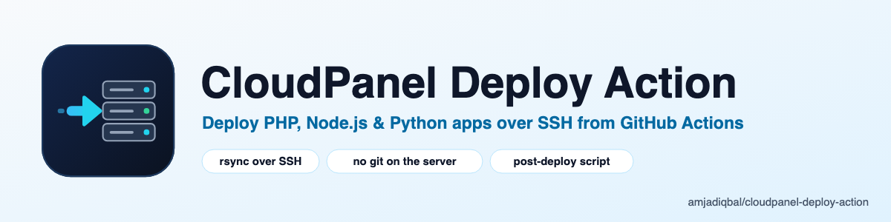

<p align="center">
  <picture>
    <source media="(prefers-color-scheme: dark)" srcset="art/banner-dark.png">
    
  </picture>
</p>

# CloudPanel Deploy Action 🚀

Deploy to your [CloudPanel](https://www.cloudpanel.io) sites instantly. This action automates the SSH connection, directory navigation, and execution of your deployment scripts.

## 🛠 Setup in 2 Minutes

1. **Add Secrets**: In your GitHub Repo, go to `Settings > Secrets` and add:
   - `CLOUDPANEL_HOST`: Your server IP address.
   - `CLOUDPANEL_SSH_KEY`: The private SSH key for your CloudPanel site user.
2. **Install**: Go to the **Actions** tab in your repo, search for "CloudPanel Deploy", and click **Configure**. This will auto-generate your workflow file.

## ⚙️ Configuration (Inputs)


| Input | Description | Required | Default |
| :--- | :--- | :---: | :--- |
| `host` | CloudPanel Server IP | Yes | - |
| `user` | CloudPanel Site User | Yes | - |
| `key` | Private SSH key for the site user | Yes | - |
| `working_dir` | Path to site (e.g. `/home/user/htdocs/site.com`) | Yes | - |
| `script` | **Custom post-deploy commands**, run in `working_dir` after the sync | No | *(empty: nothing runs)* |

## How It Works (Rsync Method) 🛠
Unlike standard git-based tools, this action uses **rsync** to sync your code. 

- **No Server-Side Git Required**: You don't need to run `git clone` or `git pull` on your CloudPanel server.
- **Safe Merging**: It copies new/updated files from GitHub and merges them into your server folder. 
- **Non-Destructive**: It will **not** delete existing files on your server (like user uploads or local logs) unless you explicitly configure it to do so.
  
### Example Workflow
```yaml
- name: CloudPanel Deploy
  uses: amjadiqbal/cloudpanel-deploy-action@v1.2.1
  with:
    host: ${{ secrets.CLOUDPANEL_HOST }}
    user: 'my-site-user'
    key: ${{ secrets.CLOUDPANEL_SSH_KEY }}
    working_dir: '/home/my-site-user/htdocs/site.com'
    script: |
      npm install
      npm run build
```

### Customizing Your Script
You can extend the `script` input to run any commands specific to your app. The files are already synced by rsync, so there is no `git pull`; for example, for Laravel:
```yaml
- uses: amjadiqbal/cloudpanel-deploy-action@v1.2.1
  with:
    host: ${{ secrets.CLOUDPANEL_HOST }}
    user: 'my-site-user'
    key: ${{ secrets.CLOUDPANEL_SSH_KEY }}
    working_dir: '/home/my-site-user/htdocs/site.com'
    script: |
      composer install --no-dev
      php artisan migrate --force
      php artisan optimize
```

## Support

- 🐛 **Bug or feature request** — [open an issue](https://github.com/amjadiqbal/cloudpanel-deploy-action/issues)
- 🔒 **Security issue** — please report privately via GitHub's security tab

## Need this customised, or something built?

I'm available for custom development, deployment pipelines, package integration, and technical consulting.

[](https://www.upwork.com/freelancers/amjadkhatri)

For priority support and custom deployment setups, please reach out via Upwork for direct assistance.

## More packages

Part of a family of open-source packages — see [all of them](https://github.com/amjadiqbal?tab=repositories).

| | |
|---|---|
| [kiln](https://github.com/amjadiqbal/kiln) | Deploy-time OPcache control for Laravel |
| [laravel-logpulse](https://github.com/amjadiqbal/laravel-logpulse) | Log health monitoring & alerting for Laravel |
